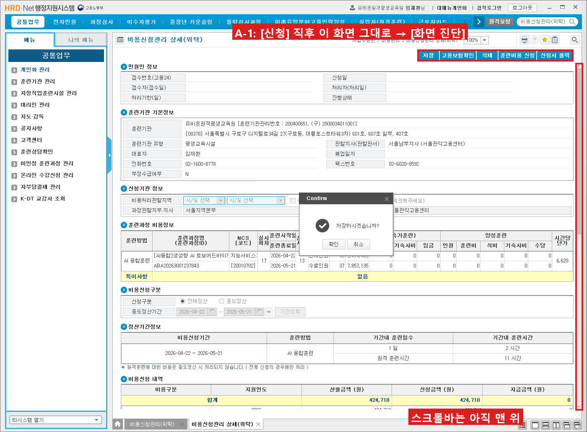
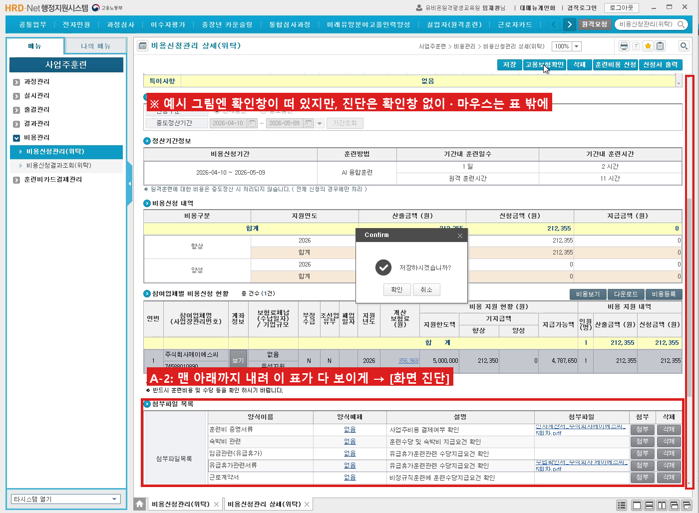

# 비용신청 자동화 v2.2.4 테스트 요청 (약 10분)

## 이번에 바뀐 것
- 요청하신 대로 **【비용등록 ~ 저장】과 [고용보험확인]을 뺐습니다.** 이제 매크로는 아래까지만 합니다.
  - 메뉴 이동 → 과정명·회차 입력 → 검색 → 「신청대상」 행 [신청]
  - → **화면을 아래로 내림** → 증빙 첨부(계산서는 「훈련비 증명서류」, 수납확인서는 「숙박비 관련」)
  - → 상단 [저장] → 「저장하시겠습니까?」 [확인] → 「완료되었습니다」 [확인] → 끝
- 비용등록, 고용보험확인, 훈련비용 신청은 지금처럼 직접 해 주세요.
- 지난번에 멈춘 이유: HRD-Net 창이 가로 1400이라 상세 화면 아래쪽(비용등록 버튼·첨부파일 목록)이 가려 있었습니다. 프로그램이 화면을 내리지 않아 버튼을 찾지 못했습니다. 이번에 내리도록 고쳤습니다.
- 수납확인서가 「유급휴가관련서류」 행에 붙던 문제도 고쳤습니다. 이제 행 이름을 보고 그 줄의 [첨부]만 누릅니다.

## 설치 (지난번과 같음)
1. https://github.com/leedonwoo2827-ship-it/Order-Cost-Manager-aside → 녹색 [Code] → [Download ZIP]
2. 새 폴더에 풀고, 예전 폴더의 `rpa\local.json`을 새 폴더 `rpa` 안에 복사
3. `setup.bat`(처음 한 번) → `run.bat`. 화면 위쪽에 **v2.2.4**가 보이면 됩니다.

## 테스트 A. 화면 진단 2번 (3분) — 누르지 않음
위치를 정확히 맞춰 주시면, 그 화면 사진으로 버튼 그림을 다시 만듭니다.

**A-1.** 10회차 「신청대상」 행 [신청]을 눌러 상세(위탁) 화면이 열린 **직후, 스크롤하지 않은 채** [화면 진단]

**A-2.** 같은 화면에서 **오른쪽 스크롤바를 맨 아래까지 내려** 「첨부파일 목록」 표(훈련비 증명서류 ~ 근로계약서, [첨부][삭제] 칸)가 다 보이게 한 뒤 [화면 진단]
- 확인창은 닫힌 상태로 해 주세요. 마우스는 표 밖에 두세요.

→ logs 폴더에 `inspect_날짜_시간.txt`·`.png`가 2쌍 생깁니다.

## 테스트 B. 미리 채워 보기 1곳 (5분, 녹화)
1. HRD-Net **첫 화면**에서 비용신청 탭의 **10회차 포커스타임 1곳**만 체크하고 「미리 채워 보기」를 누릅니다.
2. 손대지 않고 봅니다. 기대하는 순서는 이렇습니다.
   - 검색 → [신청] → 화면이 아래로 내려감 → 첨부 2개(훈련비 증명서류·숙박비 관련) → [저장] → 확인 2번 → 끝
3. ⚠ 이번에는 **[저장]까지 실제로 됩니다.** 끝난 뒤 첨부가 맞는 행에 붙었는지 봐 주세요. 이어서 비용등록·고용보험확인·신청은 직접 해 주세요.
   - 테스트용으로 첨부만 확인하실 거면 끝난 뒤 [삭제]로 지우셔도 됩니다.

## 보내 주실 것
1. 사이드 패널의 **[보낼 파일 만들기]** zip 하나. 테스트 A 진단 2쌍과 테스트 B 기록이 함께 들어갑니다.
2. 테스트 B 녹화 영상
3. 한 줄 메모: 끝까지 갔는지, 멈췄다면 패널에 나온 문구

멈춰도 zip 안에 멈춘 화면이 들어 있어서 추가로 캡처하실 것은 없습니다.
